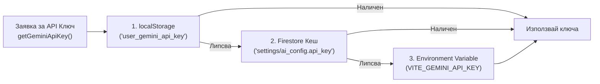

# Blueprint 08: Универсално Ядро за Комуникация с Gemini AI и Верига за Устойчивост (`geminiClient.js`)

## 1. Концепция и Бизнес Стойност
Този модул (`src/lib/geminiClient.js`) е централната комуникационна шина между приложението и Google Gemini API. Всички AI функции в приложението (Асистент, Визуален скенер, Преводачи, Модерация на текст) минават през него.
Основните му архитектурни предимства са:
1. **Хибридно управление на API ключове (BYOK + Cloud Sync + System Fallback)**: Позволява на всеки потребител да въведе собствен безплатен Gemini API ключ, синхронизира го между всичките му устройства чрез Firestore и автоматично преминава към системния ключ, ако потребителят няма личен ключ.
2. **Автоматичен Failover (`Primary Model` $\rightarrow$ `Fallback Model`)**: Ако основният модел върне грешка (претоварен сървър 503, изчерпана минутна квота 429 или спрян модел 404), клиентът автоматично и прозрачно повтаря заявката през резервния модел.
3. **Защита от увисване (`AbortController`)**: Всяка заявка има строг таймаут, предотвратяващ безкрайно въртящи се лоудъри при бавна мобилна връзка.

---

## 2. Архитектура на Хибридното Управление на Ключове



### Синхронизация на личния ключ между устройства (`syncGeminiKeyWithUserDoc`)
Когато потребителят въведе своя ключ на лаптопа си, той се записва в `localStorage` **и** в `users/{uid}.preferences.gemini_api_key`. Когато по-късно отвори приложението от телефона си, `AuthContext` автоматично изтегля ключа от Firestore и го зарежда локално, без да се налага повторно въвеждане.

---

## 3. Ключови Функции в `geminiClient.js`

### 3.1. Кеширано извличане на дистанционната конфигурация (`getRemoteAIConfig`)
За да не се прави четене от Firestore при всяко съобщение в чата:
- Конфигурацията от `settings/ai_config` се пази в паметта (`cachedRemoteConfig`) за **5 минути** (`CONFIG_CACHE_TTL_MS = 5 * 60 * 1000`).
- При промяна в `/admin/ai-config`, функцията `saveRemoteAIConfig` моментално обновява кеша в паметта.

### 3.2. Универсална функция за заявка с автоматичен Fallback и Timeout
```javascript
export const callGeminiWithFallback = async ({
  contents,
  systemInstruction,
  generationConfig = {},
  timeoutMs = 20000,
  apiKey = getGeminiApiKey()
}) => {
  if (!apiKey) throw new Error('MISSING_API_KEY');

  const cfg = await getRemoteAIConfig();
  const candidates = [
    cfg?.primary_model || 'gemini-flash-latest',
    cfg?.fallback_model || 'gemini-pro-latest'
  ].filter((v, i, a) => v && a.indexOf(v) === i);

  let lastError = null;

  for (const modelId of candidates) {
    const controller = new AbortController();
    const timer = setTimeout(() => controller.abort(), timeoutMs);

    try {
      const res = await fetch(
        `https://generativelanguage.googleapis.com/v1beta/models/${modelId}:generateContent?key=${apiKey}`,
        {
          method: 'POST',
          headers: { 'Content-Type': 'application/json' },
          signal: controller.signal,
          body: JSON.stringify({
            contents,
            ...(systemInstruction ? { systemInstruction: { parts: [{ text: systemInstruction }] } } : {}),
            generationConfig
          })
        }
      );
      clearTimeout(timer);

      if (!res.ok) {
        const errBody = await res.json().catch(() => ({}));
        throw new Error(errBody?.error?.message || `HTTP ${res.status}`);
      }

      const data = await res.json();
      const text = data?.candidates?.[0]?.content?.parts?.[0]?.text || '';
      if (!text) throw new Error('EMPTY_AI_RESPONSE');
      return { text, modelUsed: modelId };
    } catch (err) {
      clearTimeout(timer);
      lastError = err;
      // Продължава към резервния модел в candidates
    }
  }

  throw lastError || new Error('ALL_MODELS_FAILED');
};
```

### 3.3. Надежден парсър за структуриран JSON от LLM
Дори когато се подаде `responseMimeType: "application/json"`, някои модели понякога обвиват отговора в Markdown блок ```` ```json ... ``` ```` или добавят пояснителен текст преди/след обекта.
Универсалният JSON екстрактор решава това:
```javascript
export const safeParseAIJson = (rawText) => {
  if (!rawText || typeof rawText !== 'string') return null;
  const cleaned = rawText
    .replace(/^```(?:json)?\s*/i, '')
    .replace(/\s*```$/i, '')
    .trim();
  try {
    return JSON.parse(cleaned);
  } catch {
    // Търси първата '{' или '[' и последната '}' или ']'
    const match = cleaned.match(/(\{[\s\S]*\}|\[[\s\S]*\])/);
    if (match) {
      try { return JSON.parse(match[1]); } catch { return null; }
    }
    return null;
  }
};
```

---

## 4. UX Модал за Потребителски API Ключ (4-стъпково ръководство)
За да може всеки потребител лесно да си вземе безплатен ключ от Google AI Studio:
- В приложението има вградено локализирано **4-стъпково визуално ръководство** с директен линк към `https://aistudio.google.com/app/apikey`.
- Бутон за показване/скриване на ключа, бутон за валидиране на ключа и индикатор дали в момента има активна връзка с AI.

---

## 5. Готов Промпт за AI Агент (Copy-Paste за нов проект)

```markdown
Искам да създадеш централен модул `src/lib/geminiClient.js` за комуникация с Google Gemini API със следната архитектура:

1. Хибридно управление на API ключове:
   - Проверява първо `localStorage.getItem('user_gemini_api_key')`, след това глобалния ключ в `settings/ai_config` от Firestore и накрая `import.meta.env.VITE_GEMINI_API_KEY`.
   - При запис на ключ от вписан потребител синхронизира ключа в `users/{uid}.preferences.gemini_api_key`, така че да е достъпен на всичките му устройства.
2. Дистанционна конфигурация на моделите с 5-минутен TTL кеш (`getRemoteAIConfig` от `settings/ai_config`):
   - Използва `primary_model` (по подразбиране `gemini-flash-latest`) и `fallback_model` (по подразбиране `gemini-pro-latest`).
3. Функция за извикване с автоматичен failover и таймаут (`AbortController`):
   - Първо прави опит с `primary_model`. При HTTP грешка (404, 429, 503) или таймаут автоматично превключва към `fallback_model`.
4. Включи `safeParseAIJson(rawText)` помощник, който почиства евентуални markdown огради (` ```json `) и надеждно парсва JSON отговорите от модела.
```
