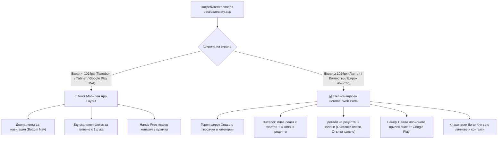

# План за Разработка: Адаптивен Десктоп Портал (Responsive Desktop Gourmet Portal)
> **Проект:** The Best Idea Eatery  
> **Официален сайт:** [https://bestideaeatery.app](https://bestideaeatery.app)  
> **Тип архитектура:** Хибридна (Mobile-First App за телефони/Google Play + Full-Width Portal за компютри)  
> **Дата на съставяне:** 12 ноември 2026 г.  
> **Статус:** Планирана следваща стъпка  

---

## 1. Концепция и Бизнес Цел

В момента **The Best Idea Eatery** е фокусирано върху мобилното изживяване – оптимизирано за телефони, работа с една ръка и гласов контрол по време на готвене. На екран на настолен компютър или лаптоп то се визуализира в централизирана колона като симулатор на телефон.

С активирането на нашия официален домейн **[bestideaeatery.app](https://bestideaeatery.app)**, много потребители ще влизат през настолен браузър (Google търсене, социални мрежи, споделени линкове към рецепти).

### Основна цел:
Да превърнем сайта на компютър в **луксозен, модерен и пълномащабен кулинарен уеб портал**, като едновременно с това **запазим 100% от текущото мобилно приложение** за потребители с телефони и за инсталираната версия от Google Play.

---

## 2. Архитектурен Модел: Как работят двата свята заедно?

---

## 3. Ключови Модули на Десктоп Версията

### Модул 1: Разширен Десктоп Хедър (`DesktopHeader.jsx`)
* **Ляво:** Стилизирано кулинарно лого „The Best Idea Eatery“ и слоган.
* **Център:** Голямо поле за бързо интелигентно търсене с мигновени предложения при писане.
* **Навигация:** Хоризонтални бутони към основните раздели:
  * 🍲 *Рецепти (с падащо меню за кухни и категории)*
  * 🌿 *Сезонно меню*
  * 🥫 *Моят Килер*
  * 🤖 *AI Шеф Асистент*
  * 👥 *Кулинарна Общност*
* **Дясно:**
  * Селектор за 6-те езика (BG, EN, ES, IT, FR, DE) с красиви флагове.
  * Бутон-камбанка за известия (вече наличният `NotificationCenter`).
  * Профил / Вход.
  * Изпъкващ златист бутон: **„📱 Вземи за Android“**.

### Модул 2: Начална страница за широк екран (Desktop Home Showcase)
* **Hero Секция:** Впечатляващ кулинарен банер с висока резолюция, представящ „Рецепта на деня“ или сезонна селекция.
* **Интелигентна лента за търсене по налични съставки:** Потребителят може направо от началния екран на компютъра да напише: *„Имам яйца, сирене и спанак“* и да получи предложения.
* **Кулинарен QR код:** Странично каре, което позволява на потребителя с 1 сканиране с камерата на телефона да си прехвърли рецептата директно в джоба за готвене в кухнята.

### Модул 3: Каталог с рецепти с Лява странична лента (Desktop Sidebar Filters)
* **Лява лента с постоянни филтри (Sticky Sidebar):**
  * Филтър по максимално време за готвене (Слайдер: до 15 мин, до 30 мин, до 60 мин).
  * Филтър по кухни (Българска, Италианска, Средиземноморска, Азиатска и др.).
  * Филтър по трудност (Лесно, Средно, Майсторско).
  * Диетични филтри (Вегетариански, Веган, Кето, Без глутен).
  * Сортиране (Най-нови, Най-популярни, Най-малко калории, Най-бързи).
* **Основна дясна зона:**
  * Модерен **грид от 3 или 4 колони** с интерактивни карти за рецепти.
  * Визуални индикатори: време за приготвяне, калории на порция, трудност и бърз бутон „Запази в любими“.

### Модул 4: Двуколонен изглед на детайлна рецепта (Two-Column Recipe Detail)
* **Лява колона (Съставки и характеристики):**
  * Голяма кулинарна снимка с висока резолюция.
  * Интерактивен калкулатор за порции (напр. от 2 на 6 порции с авто-преизчисляване на грамажите).
  * Списък със съставки с ясни кулинарни бележки и отметки.
  * Карта с хранителни стойности (Калории, Протеини, Въглехидрати, Мазнини).
  * 🖨️ **Бутон „Принтирай рецепта“:** Специален стил за печат на чист бял лист с логото на проекта, съставките и стъпките (изключително полезно за домакини и шеф-готвачи).
* **Дясна колона (Поетапно приготвяне и общност):**
  * Поетапни стъпки с акцентирани таймери и съвети от майстора.
  * Свързани вина и напитки за съчетаване.
  * Секция за коментари, оценки със звезди и снимки от потребители, сготвили ястието.

### Модул 5: Богат Десктоп Футър (`DesktopFooter.jsx`)
* Четириколонен класически информационен футър:
  * Колона 1: За The Best Idea Eatery, нашата мисия за Zero-Waste и отговорно готвене.
  * Колона 2: Бързи връзки към всички категории и национални кухни.
  * Колона 3: Инструменти (Седмичен планьор, Калкулатор за мерни единици, AI Скенер).
  * Колона 4: Правна информация (Политика за поверителност, Общи условия, Реклама и Контакти).
* Бутони за инсталиране от Google Play.

---

## 4. Пътна Карта за Изпълнение (Спринтове)

| Етап | Наименование | Задачи | Очакван резултат |
| :--- | :--- | :--- | :--- |
| **Етап 1** | **Адаптивна Рамка & Хедър/Футър** | Създаване на `DesktopHeader` и `DesktopFooter`. Настройка на Tailwind CSS брейкпойнтове (`lg:`, `xl:`), скриване на долната мобилна лента при широк екран. | Сайтът има завършена десктоп рамка без странични празни черни ивици. |
| **Етап 2** | **Каталог с Рецепти & Sidebar Филтри** | 4-колонен грид за рецепти и лява филтър лента за време, калории, кухня и диети. | Изключително лесно разглеждане и намиране на рецепти на голям екран. |
| **Етап 3** | **Двуколонен Детайл на Рецепта & Печат** | Разделяне на съставките и стъпките в две успоредни колони. Добавяне на стил за принтиране (Print CSS). | Удобно четене на монитор и възможност за разпечатване на хартия. |
| **Етап 4** | **Десктоп Начална Витрина & QR Мобилен Банер** | Разширен начален Hero екран, кулинарни колекции и QR код банер за изтегляне на мобилното приложение за Android. | Пълноценен уеб портал, стимулиращ инсталирането на мобилното приложение. |

---

## 5. Технически Гаранции

1. **0% Риск за Мобилното Приложение:** Всички десктоп промени се капсулират чрез CSS медийни правила (`min-width: 1024px`). Приложението за Android телефони остава абсолютно идентично и непокътнато.
2. **Нулево дублиране на данни:** Десктоп и мобилната версия черпят данни от една и съща база данни във Firebase. Всички преводи на 6 езика работят автоматично и на двете места.
3. **SEO Оптимизация:** Пълната десктоп версия позволява на търсачката на Google да индексира рецептите много по-високо в резултатите за търсене.
