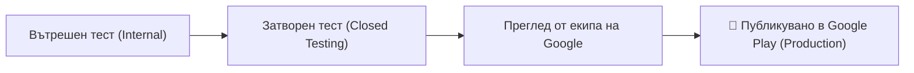

# Наръчник за Публикуване в Google Play Store: Стъпка по Стъпка на Достъпен Език
> **Приложение:** The Best Idea Eatery  
> **Версия:** 1.0.0 (TWA / PWA)  
> **Последна актуализация:** 12 ноември 2026 г.  
> **Официален домейн (Брандиран):** [bestideaeatery.app](https://bestideaeatery.app)  
> **Технически Firebase хостинг:** [project-08fabab9-ca3c-4140-9d7.web.app](https://project-08fabab9-ca3c-4140-9d7.web.app)

---

## Въведение: Какво правим накратко?

Нашето уеб приложение **The Best Idea Eatery** вече разполага с всички необходими модерни технологии (PWA манифест, офлайн кеш чрез Service Worker, адаптивни икони и преки пътища).

За да се появи като **официално приложение в Google Play Магазина**, използваме официалната технология на Google, наречена **TWA (Trusted Web Activity)**. 
- **Какво означава това на прост език?** Правим лека Android „опаковка“ (инсталационен `.aab` файл под 2 MB), която отваря нашето супер бързо уеб приложение на цял екран без адресната лента на браузъра.
- **Огромно предимство:** Когато променяме рецепти, добавяме функции или подобряваме дизайна в сайта, приложението на телефоните на потребителите се обновява **моментално и автоматично**, без да се налага всеки път да чакаме дни за ново одобрение от Google!

---

## 1. Регистрация, Такси и Задължителни Линкове

### 💳 Колко струва и кога се плаща?
* **Такса:** **$25 USD** (еднократна такса за цял живот). Google **не начислява** месечни или годишни абонаменти за профил на разработчик (за разлика от Apple, където е $99 всяка година).
* **С какво се плаща:** Международна кредитна или дебитна карта (Visa, Mastercard), с активирани онлайн плащания и 3D Secure верификация през вашето мобилно банкиране.

### 🌐 Задължителни интернет адреси (Запазете ги!)

> [!TIP] Защо собственият домейн `bestideaeatery.app` е по-добрият избор?
> Използването на вашия собствен домейн **`bestideaeatery.app`** придава 100% професионален и брандиран вид пред потребителите и пред екипа за преглед на Google Play. Служебният домейн на Firebase (`project-08fabab9-ca3c-4140-9d7.web.app`) остава напълно активен паралелно като резервен технически адрес.

| Ресурс / Стъпка | Официален Линк (bestideaeatery.app) | Резервен Линк (Firebase Hosting) | За какво служи? |
| :--- | :--- | :--- | :--- |
| **Регистрация в Google Play** | [play.google.com/console/signup](https://play.google.com/console/signup) | — | Създаване на профил на разработчик и заплащане на таксата от $25. |
| **Google Play Конзола (Табло)** | [play.google.com/console](https://play.google.com/console) | — | Главното табло за управление на приложението и формулярите. |
| **Политика за поверителност** | [https://bestideaeatery.app/privacy](https://bestideaeatery.app/privacy) | [project-08fabab9-.../privacy](https://project-08fabab9-ca3c-4140-9d7.web.app/privacy) | Задължителен линк за въпросника на Google Play. |
| **Общи условия (Terms)** | [https://bestideaeatery.app/terms](https://bestideaeatery.app/terms) | [project-08fabab9-.../terms](https://project-08fabab9-ca3c-4140-9d7.web.app/terms) | Условия за ползване на услугата. |
| **Дигитален сертификат** | [https://bestideaeatery.app/.well-known/assetlinks.json](https://bestideaeatery.app/.well-known/assetlinks.json) | [project-08fabab9-.../assetlinks.json](https://project-08fabab9-ca3c-4140-9d7.web.app/.well-known/assetlinks.json) | Сертификат за верификация на TWA без адресна лента. |
| **D-U-N-S номер** *(само фирми)* | [dnb.com/duns-number/lookup.html](https://www.dnb.com/duns-number/lookup.html) | — | Безплатен код за юридически лица (ЕООД/ООД). |

---

### 🔗 Как да свържете `bestideaeatery.app` към Firebase Hosting (2-3 минути)

Тъй като вече притежавате домейна, ето как да го накарате да отваря приложението:
1. Отворете [Firebase Console](https://console.firebase.google.com/) и влезте в проекта `project-08fabab9-ca3c-4140-9d7`.
2. В лявото меню изберете **Hosting** (под Build).
3. Кликнете бутона **„Add custom domain“** (Добави персонализиран домейн).
4. Въведете `bestideaeatery.app` (по желание може да добавите отметка и за `www.bestideaeatery.app`).
5. Firebase ще ви изпише 1 или 2 записа (обикновено **тип A** със зададени IP адреси, или **TXT** запис за проверка).
6. Влезте в контролния панел на доставчика, откъдето купихте домейна, отворете **DNS настройките** (DNS Management / Zone Editor) и добавете посочените от Firebase записи.
7. Готово! В рамките на няколко часа Google автоматично издава безплатен SSL (HTTPS) сертификат и домейнът започва да зарежда приложението веднага.

---

## 2. Необходими Документи и Верификация на Самоличността

След като заплатите таксата от $25, Google ще ви накара да преминете през процедура за потвърждение на самоличността (Identity Verification). Това е стандартна мярка срещу спам и злоупотреби.

### 👤 Вариант А: Регистрация като Физическо лице (Personal Account)
Подходящо, ако искате профилът да се води на вашето личе име.

* **1. Документ за самоличност:**
  * Снимка на **Лична карта** (от двете страни) или **Международен паспорт** (страницата със снимката).
  * *Изисквания:* Всички 4 ъгъла на документа трябва да се виждат ясно, без светлинни отблясъци или замъгляване.
* **2. Документ за потвърждение на адрес (Proof of Address):**
  * **Банково извлечение** (с печат или електронен подпис от вашето онлайн банкиране), или
  * **Битови сметки** (ток, вода, парно, домашен интернет) или месечна сметка за мобилен телефон.
  * *Изисквания:* Документът трябва да е издаден през **последните 90 дни** и да съдържа вашето пълно име и точен адрес.
* ⚠️ **Златно правило:** Имената и адресът, които въвеждате в профила за плащане на Google, трябва да съвпадат **на 100% буква по буква** с документа! Ако на личната карта пише „ул. Цветна №5, ет. 3“, в Google трябва да въведете точно това.

> [!WARNING] Важно изискване за Лични акаунти (от ноември 2023 г.)
> Google изисква от всички нови **лични акаунти** да преминат през **14-дневен затворен тест с минимум 20 тестера** преди да получат право да пуснат приложението свободно за изтегляне (вижте Раздел 6 за лесна организация).

---

### 🏢 Вариант Б: Регистрация като Фирма / Организация (Organization Account)
Подходящо, ако имате регистрирана фирма (напр. ЕООД, ООД) и искате под името на приложението в магазина да пише името на вашата компания.

* **Предимство:** Фирмените акаунти **нямат изискване** за 14-дневен тест с 20 тестера! Приложението може да бъде публикувано директно след преглед от екипа на Google.
* **Какво ви е необходимо:**
  1. **D-U-N-S номер:** 9-цифрен международен идентификатор от агенция Dun & Bradstreet. Изваждането му е напълно **безплатно** за български фирми през официалния портал на D&B (отнема обикновено между 2 и 5 работни дни).
  2. **Актуално състояние на фирмата:** Удостоверение от Търговския регистър (с валидност до 90 дни).
  3. **Сметка/Извлечение на името на фирмата:** За доказване на фирмения адрес.
  4. **Имейл с фирмен домейн:** Препоръчително е (напр. `contact@thebestideaeatery.com`).

---

## 3. Настройка в Google Play Console: Готови Отговори за Въпросниците

В конзолата на Google Play ще трябва да попълните няколко задължителни формуляра в раздела **„App content“ (Съдържание на приложението)**. Ето точните отговори, формулирани специално за нашия проект:

### 1. Достъп до приложението (App Access)
* **Въпрос:** Изисква ли приложението потребителско име и парола, за да работи?
* **Отговор:** Изберете **„All functionality is available without special access restrictions“** (Всички функции са достъпни без ограничения).
* *Защо:* Потребителите могат да разглеждат рецепти, да използват търсачката, режима за готвене и калкулатора без регистрация (като гости). Входът с акаунт е опционален само за запазване на личен килер и любими.

### 2. Реклами (Ads)
* **Въпрос:** Съдържа ли приложението ви реклами?
* **Отговор:** Изберете **„Yes, my app contains ads“** (Да, приложението ми съдържа реклами).
* *Защо:* В каталога и страницата за рецепти имаме подготвени места за спонсорирани банери и партньорски кулинарни предложения. Декларирането на това показва коректност пред правилата на Google.

### 3. Възрастова класификация (Content Rating - IARC)
* Ще преминете през кратък въпросник от 10-15 въпроса (Международен орган IARC):
  * **Категория:** Изберете **„Utility, Productivity, Communication, or Other“** или **„Food & Drink“**.
  * **Насилие, кръв, оръжия?** ➔ **Не (No)**.
  * **Сексуално или неприлично съдържание?** ➔ **Не (No)**.
  * **Език на омразата или вулгарен език?** ➔ **Не (No)**.
  * **Хазарт, истински залози или казино игри?** ➔ **Не (No)**.
  * **Продажба на контролирани субстанции (тютюн, алкохол)?** ➔ **Не (No)** (рецептите за храна не са директна търговия с алкохол).
  * **Споделя ли локация на живо с други потребители?** ➔ **Не (No)**.
* **Резултат:** Приложението ви ще получи най-чистия и достъпен рейтинг: **PEGI 3** (за Европа) и **Everyone** (за САЩ и света).

### 4. Целева аудитория (Target Audience)
* **Възрастова група:** Изберете **18 and older** (18 и повече години) или **13+**.
* **Привлича ли непреднамерено малки деца?** Изберете **„No“** (Не). Това ще ви спести тежките рестрикции на програмата за деца (Designed for Families).

### 5. Новини, COVID-19 и Финансови функции
* **Приложение за новини ли е?** ➔ **Не (No)**.
* **Свързано ли е с COVID-19 проследяване?** ➔ **Не (No)**.
* **Предоставя ли финансови заеми или банкови услуги?** ➔ **Не (No)**.
* **Правителствено приложение ли е?** ➔ **Не (No)**.

### 6. Безопасност на данните (Data Safety) – Най-важният въпросник!
Google изисква да опишете какви данни събирате. Ето точните отговори:

* **Събира ли приложението данни за потребителя?** ➔ **Да (Yes)**.
* **Всички събрани данни ли са криптирани по време на пренос?** ➔ **Да (Yes)** (използваме защитен HTTPS протокол чрез Firebase/Google Cloud).
* **Предоставяте ли възможност за изтриване на акаунта и данните?** ➔ **Да (Yes)** (потребителят може да изтрие профила си от настройките).
* **Конкретни типове данни, които декларираме:**
  1. **Лична информация (Personal Info):**
     * *Имейл адрес и Име:* Събират се само при регистрация за идентификация на акаунта (`Account management / App functionality`). Не се споделят с трети страни за реклама.
  2. **Снимки и видеоклипове (Photos and Videos):**
     * *Снимки:* Потребителят може да снима или прикачи снимка на продукт/бележка за AI Скенера. Снимките се обработват за функционалността на приложението и не се продават на рекламни брокери.
  3. **Действия в приложението (App Activity):**
     * Взаимодействия с приложението (запазени любими рецепти, продукти в килера).

---

## 4. Маркетингови Материали и Графика за Магазина

Когато потребител влезе в страницата на The Best Idea Eatery в Google Play, той вижда иконата, заглавното изображение и скрийншотите. Ето точните изисквания:

### 1. Текстово описание
* **Заглавие на приложението (до 30 символа):**  
  `The Best Idea Eatery`
* **Кратко описание (до 80 символа):**  
  `Кулинарен AI шеф, интелигентен килер за продукти и над 330 изпитани рецепти.`
* **Пълно описание (до 4000 символа):**  
  Подробно представяне на български:
  * Над 330 проверени рецепти с филтри по кухни, алергени и трудност.
  * Режим „Готвене с мръсни ръце“ с гласови команди на 6 езика.
  * Интелигентен Килер (Pantry) със следене на срока на годност и Zero-Waste предложения.
  * AI Кулинарен Асистент и скенер за разпознаване на съставки.
  * Хранителни стойности и калории за всяка порция.

### 2. Задължителни графични файлове

| Графичен елемент | Размери и формат | Къде се намира в проекта? / Инструкция |
| :--- | :--- | :--- |
| **Икона на приложението** | **512 x 512 пиксела**<br>Формат: PNG (32-bit)<br>Размер: До 1 MB<br>*Без прозрачен фон!* | Вече е готова в проекта: [`public/icons/icon-512.png`](file:///c:/Users/KAMEH%20Y3YHOB/Documents/GitHub/the-best-idea-eatery/public/icons/icon-512.png). Може директно да я свалите и качите в конзолата. |
| **Основно графично изображение (Feature Graphic)** | **1024 x 500 пиксела**<br>Формат: JPG или 24-bit PNG (без прозрачност)<br>Размер: До 15 MB | Банерът най-горе на страницата в Google Play. Представлява стилно кулинарно изображение с нашето лого и надпис „The Best Idea Eatery – Вашият кулинарен навигатор“. *(Можем да го генерираме за секунди)*. |
| **Скрийншоти от телефон (Phone Screenshots)** | **Минимум 4 бр.**<br>Препоръчителен размер: **1080 x 2400 пиксела** (или друго съотношение 16:9 / 20:9)<br>Формат: PNG или JPEG | Снимки на реалния екран на приложението: <br>1. *Начален екран с красивите категории и търсачка*<br>2. *Режим „Готвене с мръсни ръце“ с големия таймер*<br>3. *Интелигентният Килер с предупреждения за изтичащ срок*<br>4. *Детайлна рецепта с изчислени хранителни стойности* |

---

## 5. Техническо Сглобяване на Инсталационния Пакет (`.aab`)

Google Play вече не приема стари `.apk` файлове. Вместо това изисква модерен файлов формат: **Android App Bundle (`.aab`)**.

### Как става това чрез инструмента Bubblewrap?
Инструментът **Bubblewrap** е официално разработен от инженерите на Google за автоматично превръщане на PWA уебсайтове в чисти Android App Bundles.

1. **Изисквания на компютъра:**
   * Инсталиран **Node.js** (вече го имате на компютъра).
   * Инсталиран **Java Development Kit (JDK 17 или 21)** и **Android Command-line Tools**. *(При първото стартиране Bubblewrap ще ви попита дали да ги свали автоматично за вас с натискане на клавиш Enter).*
2. **Какво правим ние за вас:**
   * Агентът може да изпълни пълната команда за генериране на проекта директно в терминала:
     ```bash
     # С вашия официален домейн (препоръчително след свързване във Firebase):
     npx @bubblewrap/cli init --manifest=https://bestideaeatery.app/manifest.webmanifest

     # Или с техническия Firebase адрес:
     # npx @bubblewrap/cli init --manifest=https://project-08fabab9-ca3c-4140-9d7.web.app/manifest.webmanifest
     ```
3. **Ключ за подписване (Signing Key - Keystore):**
   * Bubblewrap ще създаде криптографски ключ с име `android.keystore`.
   * ⚠️ **МНОГО ВАЖНО:** Този файл и паролата към него трябва да се съхраняват на сигурно място (на флашка или резервно копие)! Без него в бъдеще не биха могли да се качват ръчни ъпдейти, ако някога се промени самата обвивка.
4. **Свързване на сайта с приложението (AssetLinks SHA-256):**
   * При създаването на ключа Bubblewrap извежда низ от цифри и букви (SHA-256 пръстов отпечатък).
   * Ние просто поставяме този отпечатък в нашия файл [`public/.well-known/assetlinks.json`](file:///c:/Users/KAMEH%20Y3YHOB/Documents/GitHub/the-best-idea-eatery/public/.well-known/assetlinks.json).
   * Благодарение на това, телефонът разпознава, че уебсайтът и приложението са едно и също нещо, и автоматично премахва всякакви адресни ленти!

---

## 6. Тестване, Преглед и Публикуване (Go-Live!)

Преди приложението да стане видимо за милиони потребители по света, се преминава през кратки етапи:



### Етап 1: Вътрешен тест (Internal Testing)
* Качваме първия генериран `.aab` файл в раздел **Testing ➔ Internal testing**.
* Добавяте вашия собствен имейл в списъка с тестери.
* Получавате специален линк и още същия ден можете да инсталирате приложението на личния си телефон директно от Google Play Магазина, за да се уверите как изглежда на живо!

### Етап 2: Затворен тест (Closed Testing)
* **Ако сте регистрирали Фирмен акаунт (Organization):** Можете да пропуснете този етап и да подадете заявка директно за публично пускане (Production).
* **Ако сте с Личен акаунт (Personal):**
  1. Създава се списък с 20 имейл адреса (приятели, колеги, семейство с Android телефони).
  2. Изпраща им се линк за присъединяване към теста.
  3. Те свалят приложението на телефоните си.
  4. Приложението остава активно в тестова фаза в продължение на **14 последователни дни**.
  5. След 14-ия ден в конзолата се появява бутон **„Apply for Production“** (Кандидатствай за публикуване в магазина).

### Етап 3: Официално одобрение (Google Review)
* След като кликнете бутона за публикуване, екипът на Google проверява:
  * Дали линкът към Политиката за поверителност работи (нашият е 100% готов).
  * Дали приложението стартира нормално и отговаря на описаната възрастова категория.
* Време за преглед: обикновено от **2 до 5 работни дни**.
* Получавате имейл: *„Your app is live on Google Play!“* 🚀

---

## Чеклист за изпълнение (Какво правим ние и какво правите вие)

### Ваши задачи (собственик):
- [ ] Отворете [Google Play Console](https://play.google.com/console/signup) и регистрирайте профил (такса $25).
- [ ] Качете снимка на лична карта / паспорт и документ за адрес за верификация.
- [ ] Решете дали ще регистрирате личен акаунт или фирмен с D-U-N-S номер.
- [ ] Изтеглете снимките и описанията от проекта и ги качете в секцията за представяне в магазина.

### Задачи на асистента (техническа част):
- [x] Оптимизация на кода и първоначалното зареждане (`React.lazy()` - намаляване от 5.4 MB на 70 KB).
- [x] Гласов контрол на 6 езика в режим „Готвене с мръсни ръце“.
- [x] Push нотификации и център за известия за Килера и одобрените рецепти.
- [x] Подготовка на PWA Manifest, Service Worker и икони.
- [x] Създаване на `public/.well-known/assetlinks.json`.
- [x] Публикуване на сайта и политиките за сигурност на жив сървър.
- [ ] Генериране на финалния `.aab` файл и въвеждане на финалния SHA-256 ключ веднага щом създадете вашия профил в конзолата.

---

> 💡 *Ако срещнете каквото и да е затруднение при някой от въпросите в конзолата на Google Play, просто ми напишете въпроса или екранната снимка и аз ще ви напиша точния отговор веднага!*
